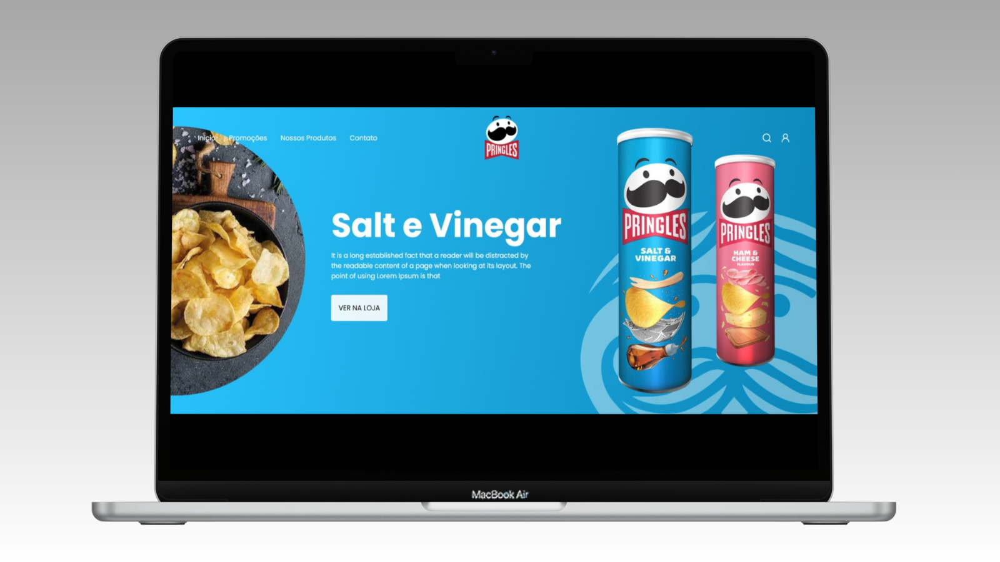

# 🥔 Pringles — Interactive Landing Page

Uma página de apresentação interativa inspirada na identidade visual da **Pringles**, desenvolvida como exercício prático de Front-end durante uma live educacional no YouTube.

---

<div align="center">



#### 🛠️ Tecnologias


</div>

________________________________________

<br>

## 📌 Sobre o Projeto

Projeto desenvolvido durante uma live no YouTube da **DevArt**, apresentada por Gustavo Campelo, como exercício prático de desenvolvimento Front-end.

A página apresenta diferentes sabores de batatas Pringles por meio de uma experiência visual dinâmica, com transições animadas e interações entre os elementos da interface.

> **Aviso:** Projeto desenvolvido exclusivamente para fins educacionais e de estudo. Não possui vínculo, parceria ou afiliação oficial com a marca Pringles.
<br>

## 🚀 Funcionalidades

- Apresentação de diferentes sabores de Pringles em formato de slides.
- Navegação entre os slides por meio do clique na miniatura do produto.
- Transições com efeito de abertura circular.
- Animação dos títulos caractere por caractere.
- Interface visual inspirada na identidade da marca.
<br>

## 🛠️ Tecnologias utilizadas

- **HTML5** — Estruturação do conteúdo.
- **CSS3** — Estilização, layout e efeitos visuais.
- **JavaScript (ES6)** — Interatividade e controle das transições.
- **GSAP** — Biblioteca utilizada para as animações.
- **GSAP SplitText** — Animação dos títulos por caractere.
- **Google Fonts (Poppins)** — Tipografia do projeto.
<br>

## 📂 Estrutura do projeto

```text
Projeto-Pringles/
├── docs/
│   └── mockup-pringles.png
├── img/
│   ├── logos e elementos decorativos
│   └── imagens dos produtos
├── index.html
├── style.css
└── script.js
```
<br>

## 📚 Aprendizados

Durante o desenvolvimento, foram praticados conceitos importantes de desenvolvimento Front-end, como:

- Manipulação do DOM com JavaScript.
- Criação de interações e navegação entre slides.
- Utilização de bibliotecas externas para animações.
- Aplicação de efeitos visuais com CSS.
- Organização e integração entre HTML, CSS e JavaScript.
<br>

## 🌐 Demonstração

Confira o projeto funcionando:

🔗 [**Projeto Online**](https://adryelsantoss.github.io/Projeto-Pringles/)

<br>
<br>

---

<div align="center">
  <sub>
    🎓 Projeto desenvolvido durante uma live da <strong>DevArt</strong>,
    apresentada por Gustavo Campelo.
    Marcas, logotipos e imagens pertencem aos seus respectivos titulares.<br>
    Desenvolvido como parte da jornada de aprendizado em Front-end. 🚀
  </sub>
</div>